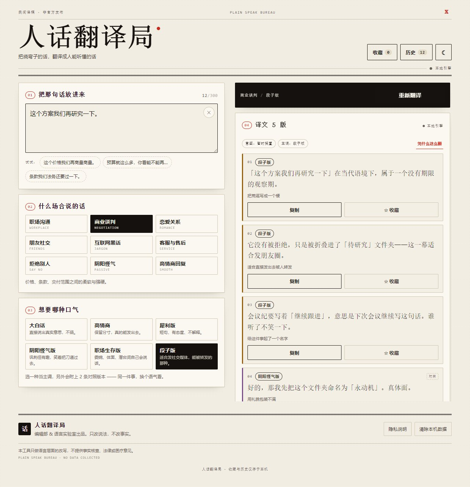
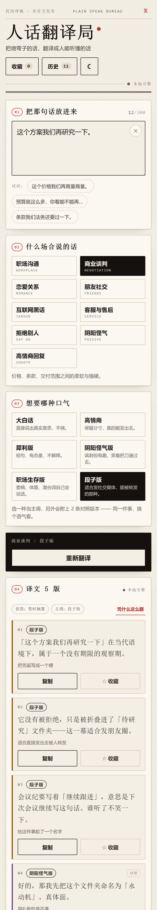
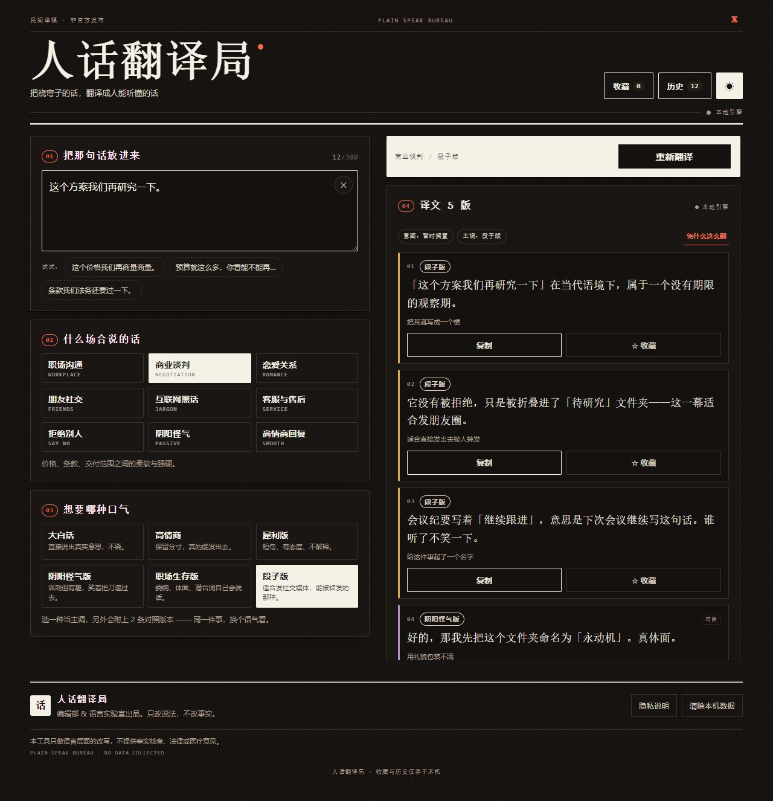
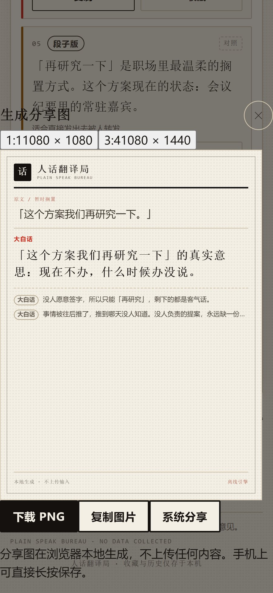
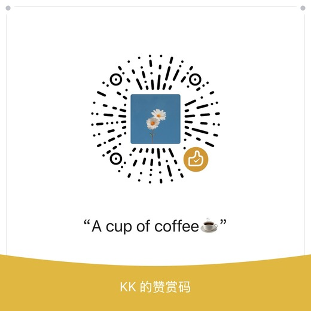

# 人话翻译局 · Plain Speak Bureau

> 把绕弯子的话，翻译成人能听懂的话。

<div align="center">

**输入一句话 → 选场合和口气 → 拿到 3~5 个语气不同、句子结构也不同的版本**

<a href="https://x.com/0xkillcoin"></a>


</div>

<div align="center">
  <a href="#它到底在做什么">功能</a> ·
  <a href="#两套引擎一句实话">引擎说明</a> ·
  <a href="#快速开始">快速开始</a> ·
  <a href="#测试与实测结果">测试结果</a> ·
  <a href="#部署">部署</a>
</div>

---

## 这是什么

中文里最难的不是说话，是**听懂对方到底在说什么**。

「这个方案我们再研究一下」——方案没问题，是没人想签字。
「下次一定」——不会再有下次。
「我这边看看，有消息同步你」——大概率不会有消息。
「我们要拉通对齐形成闭环」——我还没想清楚。

**人话翻译局**把这类话拆开：先判断它到底在表达什么意图，再按你选的口径重写成能直接用的话。

它不是一个聊天机器人，是一个**编辑台**：左边放原稿和旋钮，右边出成稿。

### 一次真实输出

<table>
<tr><td width="34%" valign="top">

**原话**

> 这个方案我们再研究一下。

**场景**：职场沟通
**口气**：大白话

</td><td valign="top">

**译文（5 版）**

**01［大白话］** 「这个方案我们再研究一下」的真实意思：现在不办，什么时候办没说。

**02［大白话］** 没人愿意签字，所以只能「再研究」，剩下的都是客气话。

**03［大白话］** 现在不办，什么时候办没说。没人负责的提案，永远缺一份材料。

**04［犀利版］** 方案没问题，缺一个敢拍板的人。别演了。

**05［段子版］** 「再研究一下」是职场里最温柔的搁置方式。这个方案现在的状态：会议纪要里的常驻嘉宾。

</td></tr>
</table>

---

## 界面

<div align="center">
  
  <br>
  <sub>桌面端：编辑部刊头 + 语言实验室的编号系统，左侧原稿与旋钮，右侧成稿</sub>
</div>

<br>

<div align="center">
  
  &nbsp;&nbsp;
  
  <br>
  <sub>左：移动端单列布局（所有可点区域 ≥ 40px） · 右：深色模式（正文对比度实测 16.7:1）</sub>
</div>

<br>

<div align="center">
  
  <br>
  <sub>分享图：1:1 与 3:4 两种比例，浏览器本地渲染 1080px PNG</sub>
</div>

---

## 它到底在做什么

### 9 个场景

职场沟通 · 商业谈判 · 恋爱关系 · 朋友社交 · 互联网黑话 · 客服与售后 · 拒绝别人 · 阴阳怪气 · 高情商回复

每个场景自带示例句、称呼词和收尾语，点一下示例就能试。

### 6 种口气

| 口气 | 在干什么 | 例句（同一个「研究一下」） |
| --- | --- | --- |
| **大白话** | 直接说出真实意思，不绕 | 目前没人想拍板，先放着。 |
| **高情商** | 保留分寸，真的能发出去 | 这个决定影响面有点大，我想先跟相关同事对一遍再回你。 |
| **犀利版** | 短句、有态度、不解释 | 不是要研究，是没人愿意签字。 |
| **阴阳怪气版** | 讽刺但有趣，笑着把刀递过去 | 研究得非常认真，进度一动不动。 |
| **职场生存版** | 委婉、体面，潜台词自己会说话 | 现阶段暂不具备推进条件。 |
| **段子版** | 适合发社交媒体，能被转发 | 它没有被拒绝，只是被折叠进了「待研究」文件夹。 |

**每次输出 5 个版本：3 条主口气 + 2 条对照口气。**

关键点：差异是**句法层面**的，不是换同义词。每种口气有 6~7 条不同句型模板，各配自己的素材池，所以五条结果的句子结构本身就不同——实测两两字符重合度 < 0.37。

### 完整功能

| 功能 | 细节 |
| --- | --- |
| 输入 | 手动输入 / 点示例填充 / 一键清空 / 实时字数统计（300 字上限，超了变红拦截） |
| 生成 | 加载骨架屏、错误提示、单飞锁（连点三次只发一次请求） |
| 复制 | 每条单独复制、一键复制全部（带编号）、单独复制 X 文案 |
| 换一批 | 换随机种子重新组合，同一种子可复现 |
| 收藏 / 历史 | 存本机 localStorage，可看、可删、可「载入重翻」；历史最多 30 条，收藏 200 条 |
| X 短文案 | 按 X 字数权重估算（汉字记 2），超限自动裁剪 |
| 分享图 | 1:1（1080×1080）/ 3:4（1080×1440），浏览器本地渲染，支持系统分享 |
| 深色模式 | 跟随系统，可手动切换并记住；正文对比度 16.7:1（WCAG AAA 要求 7:1） |
| 无障碍 | 单选组用 WAI-ARIA roving tabindex：方向键切换、Home/End 跳首尾、整组只占一个 Tab 停留点 |
| 隐私 | 默认本地生成，**不保存用户输入的原文**，不埋点、不建账号 |

---

## 两套引擎，一句实话

### 离线引擎（默认，无需任何 Key）

不做「随机拼接假装 AI」。它明确只做三件事：

**1. 识别意图** —— 人工整理的 **19 类意图词库**：

> 暂时搁置 / 等通知 / 客气拒绝 / 明确说不 / 要个说法 / 等回音 / 要个态度 / 想砍价 / 最后通牒 / 话里有话 / 黑话 / 按规则办不了 / 道谢 / 认错 / 请示提要求 / 催兑现 / 责备追究 / 画饼 / 无明确潜台词

命中片段的长度参与打分；客套类（道谢 / 认错）带负权重——「不好意思，这个我做不了」的实质是拒绝，不该判成道歉。

**2. 抽取要素** —— 从原句里捞出「被谈论的对象」（这个方案、那份预算…）和称呼（王总、李经理）。捞不到就留空，**不凭空编造**。

**3. 按风格配方重排** —— 每种口气 6~7 条句型模板 + 该口气专用素材池，素材在批内去重。

**诚实标注做在产品里，不是写在文档里：**

- 命中不了任何意图 → 降级为「无明确潜台词」，置信度标 `low`，结果只如实说「这句可以照字面理解」，**不硬编动机**（不会把「我妈让我早点回家」翻译成「有人想甩锅」）；
- 结果区有「凭什么这么翻」按钮，展开能看到命中了哪条句式、判定了什么意图、识别到什么对象；
- 离线时会明确写一句：**这是本地规则引擎，靠人工词库 + 句法模板生成，不是模型理解**。

### 模型通道（可选）

- 前端启动时探一次 `GET /api/health`，有模型才显示「模型 / 本地」切换按钮
- **密钥只从服务端环境变量读**，前端拿不到，也不写日志
- 供应商封装在 `server/adapters/`，换供应商只加一个文件，不碰业务代码
- 模型返回必须过清洗：坏 JSON、条数不足 3 条、出现重复，一律判失败
- 失败时**如实提示错误码 + 自动降级到本地引擎**，不让用户空手而归

### 错误处理一览

| 情况 | 处理 |
| --- | --- |
| 空输入 | 输入框下红字提示，不发请求 |
| 超长输入（>300 字） | 计数变红 + 拦截提交 |
| 模型未配置 | 服务端 503 + `code=ai_unavailable`，前端静默走本地 |
| 模型超时 / 限流 / 500 | 提示具体原因（带错误码）+ 自动降级本地 |
| 模型返回坏 JSON / 条数不足 | 判失败走降级，不把脏数据塞进界面 |
| 前端连不上服务端 | 静默走本地，不弹错误打扰 |
| 复制失败 | 降级到 `execCommand`，再失败提示手动选中 |
| localStorage 不可用 | 静默降级，如实说明「当前浏览器禁用本地存储」 |
| 连点翻译 | 单飞锁，只发一次请求、只写一条历史 |

---

## 快速开始

```bash
# 1. 安装（会提示批准 esbuild 安装脚本，同意即可）
npm install

# 2. 起开发服务器
npm run dev
# → http://127.0.0.1:5190
```

到这一步就能用了 —— **不用起后端，不用配密钥，离线引擎功能完整。**

想连模型通道（可选）：

```bash
# 复制环境变量模板
cp .env.example .env        # Windows: Copy-Item .env.example .env

# 编辑 .env，填入：
#   AI_API_KEY=你的密钥
#   AI_BASE_URL=https://api.deepseek.com/v1
#   AI_MODEL=deepseek-chat

# 起后端
npm run dev:api             # → http://127.0.0.1:8787

# 再起前端（vite 会把 /api 代理到 8787）
npm run dev
```

生产构建：

```bash
npm run build               # 产出 dist/
npm start                   # 用 server/index.mjs 同时托管 dist/ 与 /api（同源部署）
```

---

## 项目结构

```
plain-speak-bureau/
├─ src/
│  ├─ data/                    # 数据层：只有内容，没有逻辑
│  │  ├─ scenes.ts             #   9 个场景（称呼、名词、收尾语、示例句）
│  │  ├─ styles.ts             #   6 种口气 + 各自的「句法配方」
│  │  ├─ intents.ts            #   19 类意图 × 6 种口气的素材库
│  │  ├─ extras.ts             #   动作句、梗池（职场池与通用池分开）
│  │  └─ site.ts               #   站点常量、字数限制、隐私文案
│  ├─ engine/                  # 离线引擎：纯函数，可单测
│  │  ├─ analyze.ts            #     意图识别 + 实体/称呼抽取
│  │  ├─ compose.ts            #     按配方组装，去重、收敛标点
│  │  ├─ xpost.ts              #     X 文案 + 权重估算
│  │  ├─ random.ts             #     确定性随机（同语义同结果）
│  │  ├─ ai-merge.ts           #     把模型结果并成统一形状
│  │  └─ generate.ts           #     对外入口 + 输入校验
│  ├─ lib/
│  │  ├─ api.ts                #   模型调用封装（换供应商只改服务端）
│  │  ├─ clipboard.ts          #   复制（含降级）
│  │  ├─ image.ts              #   DOM → PNG、系统分享
│  │  ├─ serialize.ts          #   结果文本序列化
│  │  └─ storage.ts            #   localStorage 封装（含形状校验）
│  ├─ components/              # 只负责渲染
│  ├─ hooks/                   # useTheme / useToast / useRadioGroup
│  ├─ styles/                  # global.css（界面）、share.css（分享卡）
│  └─ App.tsx                  # 编排：状态、单飞、收藏、历史
├─ server/
│  ├─ index.mjs                # HTTP 服务：校验、限流、超时、错误码、静态托管
│  ├─ providers.mjs            # 供应商注册表
│  ├─ prompts.mjs              # 提示词（仅服务端）
│  ├─ shared-schema.mjs        # 前后端共享的枚举与上限
│  └─ adapters/
│     ├─ base.mjs              #   ProviderError、JSON 解析、输出清洗
│     ├─ openai-compatible.mjs #   OpenAI / DeepSeek / Moonshot / 自建网关
│     └─ mock.mjs              #   联调用，不联网
├─ scripts/                    # 6 套测试与质检脚本
├─ docs/images/                # README 截图
├─ .github/workflows/          # GitHub Pages 自动部署
└─ .env.example
```

**数据、提示词、适配器分三个地方放，互不越界**：改词库不碰 UI，换模型不碰前端，改提示词不碰业务逻辑。

---

## 环境变量

完整示例见 [`.env.example`](.env.example)。关键几项：

| 变量 | 默认 | 说明 |
| --- | --- | --- |
| `PORT` | `8787` | 服务端端口 |
| `AI_API_KEY` | 空 | **留空即关闭 AI**，前端走本地引擎 |
| `AI_BASE_URL` | `https://api.deepseek.com/v1` | OpenAI 兼容接口地址 |
| `AI_MODEL` | `deepseek-chat` | 模型名 |
| `AI_PROVIDER` | `openai-compatible` | 也可设 `mock`（联调，不联网） |
| `AI_TIMEOUT_MS` | `25000` | 单次上游超时 |
| `AI_TEMPERATURE` | `0.9` | 采样温度 |
| `RATE_LIMIT_PER_MIN` | `20` | 每 IP 每分钟请求数，`0` 为不限 |
| `SERVE_STATIC` | `true` | 是否用该服务托管 `dist/` |
| `ALLOWED_ORIGINS` | 空 | 需要跨域时才填，逗号分隔 |

> `AI_API_KEY` **只能**出现在服务端环境变量里。`.gitignore` 已排除 `.env`、`.env.*`，只保留 `.env.example`。

---

## 测试与实测结果

一共 6 套测试，`npm run test:all` 一次跑完（含构建）。

```bash
npm run build        # tsc -b && vite build
npm run test         # 引擎自测（纯 Node，不需要浏览器）
npm run test:tone    # 语气一致性抽查
npm run test:api     # 服务端接口冒烟
npm run test:ai      # 模型通路的浏览器端验证
npm run test:e2e     # 浏览器 E2E（Puppeteer + 本机 Chrome）
npm run test:layout  # 多视口排版与对比度审计
```

| 套件 | 断言数 | 结果 | 覆盖什么 |
| --- | --- | --- | --- |
| `test` | **339** | ✅ | 词库完整性（每个意图 6 种素材都齐）、意图识别（21 句真实样例）+ 4 句无潜台词样本（必须判 generic、不许编造动机）、实体抽取、emoji/多行/超长、条数、去重、**版本差异度（两两字符重合 < 0.78）**、场景/口气确实生效、换一批可复现、X 权重、序列化 |
| `test:tone` | **2256** | ✅ | 9 场景 × 6 口气全量扫描：非职场场景不得出现公文腔、职场场景不得出现亲密语气、每批至少一条引用原文、无未替换槽位、无空标点/重复标点、5 条结果开头不撞车；另有 6 句额外样本（请假/催兑现/责备/画饼等）在全部场景下复检 |
| `test:api` | **41** | ✅ | 无密钥 → 503 `ai_unavailable`；mock 正常返回；空输入/超长/坏 JSON/错方法/未知路径；超大请求体；模型 error / badjson / timeout 的错误映射；限流 |
| `test:ai` | **24** | ✅ | 有模型时前端走模型通道、来源徽标正确、切回本地不再请求；模型报错时如实提示并降级且仍有结果；纯静态托管（无后端）全部功能可用 |
| `test:e2e` | **83** | ✅ | 示例填充/计数/清空/空输入/超长；5 条结果相关且差异大；换场景换口气生效；换一批；单条/全部/X 文案复制（读回剪贴板逐字比对）；收藏增删 + 刷新后仍在；历史载入与删除；连续点三次只发一次请求、只写一条历史；**输入原文不落盘、刷新后输入框为空但选项保留**；键盘可达性（方向键切换单选项、End 跳末项、回车触发翻译）；分享图 1:1 与 3:4 真实下载并检查体积；深色模式对比度与主题记忆；移动端无横向溢出、可点区域 ≥40px；控制台无异常 |
| `test:layout` | **66** | ✅ | 7 个视口（320~1600px）无横向滚动/无元素越界/双栏与单栏各自不重叠；移动端输入框 16px、正文 17px；浅色与深色对比度（正文 16.4:1 / 16.7:1）；分享卡 360×360 与 360×480 内容不溢出；长句/多行/无空格长串/emoji 均不溢出 |

**合计 2809 项断言全部通过。**

### 验收清单对照

| 要求 | 怎么验证的 |
| --- | --- |
| 不同句子能否输出相关且差异明显的版本 | `test` 里 9 句真实样例：相关性（至少 2 条命中意图素材或引用原文）+ 差异度（两两字符重合 < 0.78）；E2E 用不同句子验证结果确实变化 |
| 切换场景和口气是否生效 | `test` 断言同句换口气/换场景结果不同；E2E 点按钮后验证「结果已过期」提示与新结果 |
| 复制、收藏、历史、重新生成是否正常 | E2E 读回剪贴板逐字比对；收藏刷新后仍在；历史载入重翻与逐条删除；换一批内容不同 |
| 无 API Key 时基础功能是否仍然可用 | `test:api` A 段 + `test:ai` C 段：无密钥/无后端时全部功能照常，且不产生多余网络请求 |
| 移动端布局是否正常 | `test:layout` 7 视口 + E2E 移动端段：无横向溢出、可点区域 ≥40px、弹层不溢出 |
| 构建是否通过 | `npm run build`（`tsc -b` 严格模式 + vite 构建）✅ |

<details>
<summary><b>想看全部输出措辞？</b>（点开）</summary>

```bash
npm run test:sample                    # 全部场景 × 全部口气
node scripts/sample-dump.mjs romance   # 只看某个场景
```

</details>

---

## 部署

### 方案 A：GitHub Pages（纯静态，最省事）

仓库已内置 [`.github/workflows/deploy-pages.yml`](.github/workflows/deploy-pages.yml)：

1. 推到 `main` 分支
2. 仓库 **Settings → Pages → Source** 选择 **GitHub Actions**
3. 等 Actions 跑完，访问 `https://<用户名>.github.io/<仓库名>/`

**这种形态下没有 `/api`**，`/api/health` 探测失败会被静默忽略，界面显示「本地引擎」，**全部功能照常可用**（除了模型通道）。

因为构建用 `base: './'`，放子目录也没问题，不需要改配置。

### 方案 B：一个 Node 进程同时托管前端与接口（要模型能力用这个）

```bash
npm ci
npm run build
AI_API_KEY=... AI_BASE_URL=https://api.deepseek.com/v1 AI_MODEL=deepseek-chat \
PORT=8080 npm start
```

- 页面与 `/api` 同源，没有 CORS，也没有额外的反向代理
- 想关掉模型，把 `AI_API_KEY` 留空即可，前端自动走本地
- 反向代理（Nginx / Cloudflare）只需把 `/` 全量转发到该端口

### 方案 C：前端托管 + 独立后端

```bash
# 后端
AI_API_KEY=... ALLOWED_ORIGINS=https://your.site PORT=8787 npm start

# 前端构建时把 /api 指到后端
VITE_API_ORIGIN=https://api.your.site npm run build
```

### 方案 D：Cloudflare Pages / Vercel

两边都是「构建命令 `npm run build`，输出目录 `dist`」，纯静态即可。
要模型能力就把 `server/` 单独跑在一个 Node 环境（Cloudflare Workers 需把适配器改成 fetch handler，Vercel 可直接用 Node Serverless Function 包一层 `server/index.mjs`）。

---

## 设计说明

**编辑部 × 语言实验室**：米白纸底 + 极淡网点纹理，衬线大标题（宋体族），双线报头、编号小节、等宽细字做技术注释。红色只用于强调与错误，不做装饰。

结果卡片按口气给不同的左边线颜色——大白话=墨黑、高情商=墨绿、犀利=朱红、阴阳=紫、职场=靛蓝、段子=赭黄，一眼能对比。

移动端优先：单列布局，所有可点区域 ≥ 40px（主按钮 44~50px），输入框 16px 防 iOS 聚焦缩放，选项两列、桌面三列。

深色模式是**重新配色**而不是反色：正文对比度按 WCAG AAA（≥7:1）实测达标，实测 16.7:1。

**不是聊天机器人界面**：没有气泡、没有对话流、没有头像。是「编辑台」。

---

## 已知边界

- **离线引擎的能力上限是词库**。它擅长中文里高频的场面话，遇到从没见过的说法会诚实退化成「无明确潜台词」，并在界面上标出来。要真正的语义理解，需要配模型。
- 模型通道目前只实现 OpenAI 兼容协议；其它协议需加一个 `server/adapters/*.mjs` 并在 `providers.mjs` 登记。
- 收藏与历史存 localStorage，换浏览器/清缓存就没了；这是隐私取舍，不是缺陷。
- 分享图依赖 `html-to-image`（SVG foreignObject），极老浏览器可能不支持，此时会提示改用「复制文字」。
- 内容全部为本项目原创撰写，未使用任何第三方数据集。

---

## 支持

如果这个项目让你笑了一下，或者帮你少说了一句蠢话，可以请作者喝杯咖啡。

<div align="center">
  
  <br>
  <sub>扫码打赏 · 完全自愿 · 不打赏也完全免费用</sub>
</div>

---

## 链接

- **作者**：[𝕏 @0xkillcoin](https://x.com/0xkillcoin)
- **问题反馈**：[Issues](../../issues)

---

## License

[MIT](LICENSE) © [@0xkillcoin](https://x.com/0xkillcoin)

---

<div align="center">
  <sub>有些话不用翻译，听的人自己会补完。</sub>
</div>
